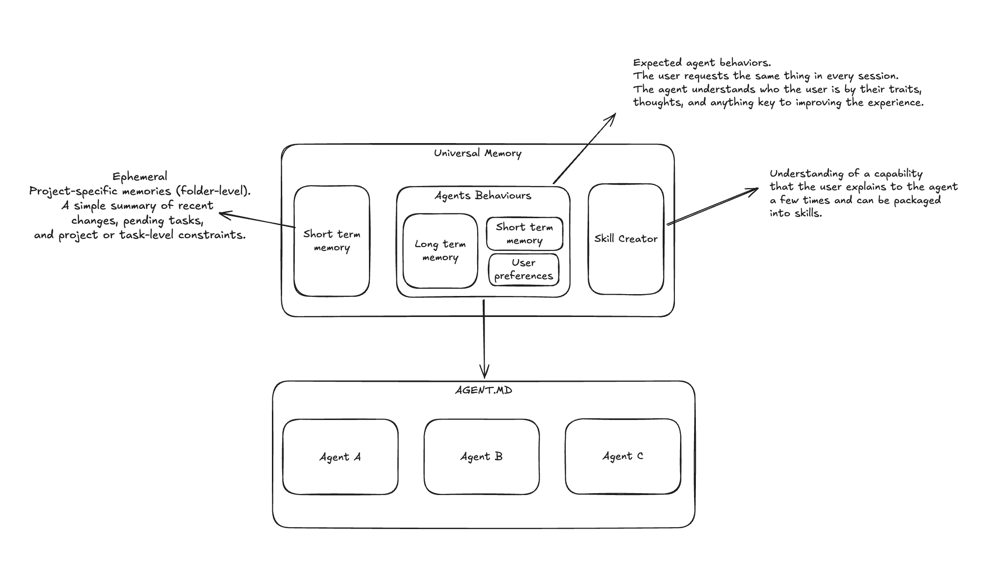

<p align="center">
  
</p>

# Universal Memory (UMem)

[](https://pypi.org/project/universal-memory/)
[](https://pypi.org/project/universal-memory/)
[](https://github.com/YanAmorelli/universal-memory/blob/dev/LICENSE)

**[Website](https://universal-memory.com)** | **[Documentation](https://docs.universal-memory.com)**

A vendor-agnostic cognitive persistence layer for AI agents. Eliminate the "repetition tax" by transporting your context, preferences, guidelines, and history seamlessly across sessions, IDEs, and LLM models.

To see the core idea visually, check out the [Excalidraw design](https://excalidraw.com/#json=j3XjQIWMYEnkIzHpypuBb,rNJaVOECDGZ3WSuEYcCDjQ) or the proposal structure:



### Diagram Breakdown

*   **Short-Term Memory (Ephemeral):** Project-specific (folder-level) memories. A simple summary of recent changes, pending tasks, and project or task-level constraints.
*   **Agents Behaviours:** Comports the user's expected agent behaviors. Instead of requesting the same settings in every session, the agent understands the user by their traits, thoughts, and any context key to enhancing the overall experience. This encompasses:
    *   **Long-Term Memory**
    *   **Short-Term Memory**
    *   **User Preferences**
*   **Skill Creator:** Encapsulates understanding of specific workflows. When a user explains a task pattern multiple times, the system translates it into structured, reusable agent skills.
*   **Unified Instruction File (`AGENTS.md`):** The shared persistence endpoint consumed by compatible local agent instances (e.g., Agent A, Agent B, Agent C).

---

## The Problem: The "Repetition Tax"

Every time you open a new session in Claude Code, start a new chat in Cursor, spin up a terminal with OpenCode, or invoke a local AI assistant, you pay a steep cognitive tax:
* Re-explaining your stack (e.g., "We use Python 3.12, Typer, and Ruff").
* Repeating coding style preferences (e.g., "Prefer functional design, do not write docstrings unless requested").
* Copy-pasting database connection schemas or module layouts.
* Explaining workflow methodologies (e.g., "We follow Spec-Driven Development (SDD)").

Universal Memory acts as a local persistence layer that automatically connects to your AI runtimes, aligning them to your exact workflow, context, and rules with zero friction.

---

## Key Architectural Concepts

### 1. Dual-Memory Model
*   **Short-Term Memory (Project Scope):** Ephemeral, directory-specific context. Tracks what you did 10 minutes ago, current active tasks, and immediate constraints.
*   **Universal Memory (Global Scope):** Long-lived preferences, style guidelines, tool configurations, and identity.

### 2. Auto-Adaptation Engine
Instead of copy-pasting instructions, `umem` monitors your session context and automatically updates active project instruction manifests (`AGENTS.md`, `CLAUDE.md`, `.cursor/rules/`, etc.), enforcing operational consistency across all agents.

### 3. Model Context Protocol (MCP) Integration
Integrate `umem` natively with any client supporting the standard MCP (such as Claude Desktop or Cursor). AI agents can programmatically retrieve context, learn new facts, and suggest skills on the fly.

### 4. Agent Skills Standard
Encapsulates complex, repetitive procedural instructions into formal Agent Skills
(conforming to the [agentskills.io](https://agentskills.io) standard), complete with
structured directories containing `SKILL.md` instructions, helper `scripts/`, and
documentation `references/`.

Universal Memory keeps one canonical source for each skill. Shared, user-facing project
skills live under `umem/skills/<slug>/SKILL.md`; private, operational, and legacy project
skills live under `.umem/skills/<slug>/SKILL.md`. Native runtime folders such as
`.agents/skills/`, `.opencode/skills/`, and `.antigravity/rules/` receive complete
synchronized copies so each agent can consume the same skill in its expected layout.

---

## Installation & Setup

Ensure you have Python 3.12+ installed. You can run or install `umem` using your preferred package manager.

### Try instantly with `uvx`
You can run `umem` without installing it permanently:
```bash
uvx --from universal-memory umem --help
```

> [!WARNING]
> `uvx` is best for quick trials. For ongoing use, install Universal Memory as a persistent tool so `umem` is always available and can fully manage long-lived global memories and synced agent skills:
> ```bash
> uv tool install universal-memory
> ```

### Install via PyPI
```bash
pip install universal-memory
```

### Upgrade Universal Memory
`umem update` does not upgrade the Python package from PyPI. It performs local, offline
maintenance for the current `.umem` workspace, such as schema migrations, benchmark refreshes,
and skill synchronization.

To upgrade the installed `umem` executable, use the package manager that installed it:

```bash
# If installed with uv tool
uv tool upgrade universal-memory

# If installed with pipx
pipx upgrade universal-memory

# If installed with pip
python -m pip install --upgrade universal-memory

# If running temporarily with uvx
uvx --refresh --from universal-memory umem --version
```

Confirm the executable you are running:

```bash
umem --version
which umem
```

Upgrading the executable does not silently mutate existing projects. The next time you
work in an initialized project, reconcile it locally:

```bash
umem update --check
umem update
umem update --skills
umem connect
umem doctor
```

You do not need to run `umem init` again. Local maintenance creates snapshots and audit
records before UMEM-owned writes. Existing `.umem/skills/use-universal-memory/` trees and
customized managed files are preserved; if both legacy and canonical Universal Memory
skill roots exist, UMEM stops for an explicit migration decision instead of merging or
deleting either tree.

---

## Quick Start Guide

Git worktrees share **unversioned** project memory with the main checkout,
including commands run from subdirectories. When the active layout's
`facts.jsonl` is tracked in the current worktree's Git index, memory belongs to
that worktree/branch instead; the main checkout need not be initialized.
This applies to `.umem/memory/facts.jsonl` in the legacy layout and
`umem/memory/facts.jsonl` in the shared layout (including configured shared roots).
Tracking only config, or tracking facts only in the main checkout's branch,
does not select local memory. Git discovery/index errors fail closed.
Host instructions such as `CLAUDE.md` and generated native skill files remain in
the current worktree; canonical skills follow its selected memory owner.
`connect` persists runtime configuration and its config snapshots at the memory
owner (normally the main checkout); host instructions still target the active checkout.
An initialized nested subproject owns its memory and host files only when its
complete `umem init` layout exists. Incomplete nested layouts fall back to the
checkout's memory with a warning. To deliberately initialize a nested subproject,
run `UMEM_MEMORY_ROOT="$PWD" umem init` from that subdirectory; later commands
discover the completed layout without the override. Legacy incomplete layouts at
the checkout root remain usable as described below.
For a bare repository, the shared memory lives in the bare repository's
`.umem/` directory. Outside Git, UMEM uses the nearest ancestor containing `.umem/`,
or the current directory for a new project.

Set `UMEM_MEMORY_ROOT` to a checkout directory to explicitly select another memory
owner (for example, the current worktree). Existing local memory is never moved or
deleted: UMEM warns when local records are excluded by the shared-root selection.
Review those records before removing a worktree.

Git discovery failures stop project resolution before writing. Discovery uses
portable Git options and supports submodule worktrees. A linked worktree created
from `--separate-git-dir` may have no authoritative backlink to the main checkout;
UMEM then requires an explicit `UMEM_MEMORY_ROOT` instead of choosing Git metadata.
In a container with `.git` pointing to `.bare`, memory belongs to `.bare` while
host files belong to the container or active linked worktree.

Project mutations require initialization. Interactive commands ask before creating
memory; JSON output, noninteractive commands, and MCP return an initialization error
with `memory_root` and instructions to ask the person and run `umem init`. Global
commands remain available without project initialization.
An older initialized project is recognized by valid project/host configuration
and its memory directory even when newer optional benchmark files are missing.
`umem update --migrate` can repair that older layout; `doctor` still reports
incomplete layout components. Audit or host remnants alone do not initialize a
project.

Concurrent writers use kernel leases alongside legacy UUID lock files, with a
2-second acquisition timeout (audit keeps its configured timeout). Updated writers
pin the legacy lock timestamp in the future to prevent ordinary age expiry of
that inode, including while the writer is suspended. This is a partial fence:
an old reader with a cached stale mtime from a previous owner can still unlink
the new lock and cause lost records. A previous updated owner's
lock is recovered only after its kernel lease ends and its token and inode match.
An unknown old lock is never evicted by age or a guessed PID; after an old crash,
recovery may require stopping every writer and reviewing that lock manually.

**Mandatory upgrade procedure: close all old CLI commands and MCP servers,
update every executable and integration pin, then restart those sessions before
writing memory with this change.** An
executable upgrade alone does not replace code already loaded by an MCP server.
Old rollback, initialization, config and direct SafeWrite paths do not acquire the
repository locks; new code cannot force them to cooperate. The compatibility
fence covers the tested two-writer contention cases, not every legacy interleaving.
See [the compatibility analysis](docs/mixed-version-locks.md) for evidence and limits.
Follow the [PR upgrade notes](docs/pr99-upgrade-notes.md) before upgrading.

FAT32 and exFAT are unsupported. Storage requires reliable POSIX locks, hard
links and preservation of nanosecond timestamps through the 2255 lock fence.
Unsupported timestamp or hard-link capabilities fail before protected writes;
use a supported filesystem instead of retrying initialization to repair it.

### 1. Initialize your project

Open your project directory and run:

```bash
umem init
```

Universal Memory detects the agents already used in the workspace, presents one
combined confirmation, configures the best available project integration, and
verifies that the agent can read project context. You do not need to choose an
integration mechanism or know which instruction files it uses.

When a compatible agent needs the portable Agent Skill, UMEM discloses any
network use and external project-scoped copy before confirmation, disables
anonymous installer telemetry, and treats a missing prerequisite or failed
installation as recoverable instead of blocking initialization.

To connect another agent later, run:

```bash
umem connect
```

Explicit runtime selection remains available for automation and unusual setups,
but it is not required for the normal path.

<details>
<summary>How the portable Tier 2 installation works</summary>

UMEM resolves the detected agent's project skill directory from a reviewed catalog
pinned to `skills@1.5.20`, runs one project-scoped installation, and validates the
complete installed skill tree plus a real `umem context` read. It does not install into
a second project and copy the result back.

The command orchestrated by UMEM in `v0.6.4` is equivalent to:

```bash
DISABLE_TELEMETRY=1 npx --yes skills@1.5.20 add https://github.com/YanAmorelli/universal-memory/tree/v0.6.4/skills/universal-memory --skill universal-memory --agent pi --copy -y
```

Here `pi` is an example; UMEM supplies the detected agent ID. Node.js and `npx` are
optional prerequisites for this external bridge. When either is unavailable,
initialization remains usable and UMEM reports a managed or manual fallback. Unknown
agent IDs never execute `npx`.

</details>

### 2. Bootstrap one agent session

At the start of each conversation or agent session, prefer the MCP `bootstrap()` tool when
it is connected. Otherwise, use the equivalent CLI command:

```bash
umem bootstrap --format json
```

This single call validates the integration and returns project status, active project
context, and the skills catalog. Treat `data.context` as active context, inspect
`data.skills.list`, and request details only for skills relevant to the current task:

```bash
umem skills detail <skill-id-or-name> --format json
```

Run bootstrap only once per conversation or session. It replaces the previous startup
sequence of separate `status`, `context`, and `skills list` calls; it does not perform
installation, synchronization, or configuration.

### 3. Save your first preferences and facts
Tell `umem` what to keep in mind. You can target either the project scope (this folder) or the global scope (across all projects):
```bash
# Save a global preference
umem remember --scope global "Yan is a solutions architect specializing in AI applications"

# Save a project-specific constraint
umem remember --scope project "Always use Tomllib instead of PyYAML for configuration files" --tag config
```

### 4. Retrieve Context
Verify the consolidated context summary generated by combining short-term facts, rules, and global preferences:
```bash
umem context --scope project
```

### 5. Adopt or create an Agent Skill

If a skill already exists, choose the safest adoption path first. Use `adopt` for an
existing `.umem/skills/<slug>` directory; use `import` for native runtime directories
such as `.agents/skills/<slug>` and sync it back out to configured runtimes:

```bash
umem skills adopt .umem/skills/review-protocol --scope project
umem skills import .agents/skills/review-protocol --scope project --sync
umem skills detail review-protocol
```

If you are starting from scratch, draft and publish it without native side effects:

```bash
umem skills draft create \
  --name "Review Protocol" \
  --description "Reusable review workflow" \
  --trigger "when reviewing code"
umem skills draft validate review-protocol
umem skills publish review-protocol --format summary
```

For a one-step workflow, create the canonical skill. It is canonical-only by default;
request sync explicitly when native runtime targets should be written:

```bash
umem skills create \
  --name "Review Protocol" \
  --description "Reusable review workflow" \
  --trigger "when reviewing code" \
  --format summary
umem skills sync review-protocol --check-gitignore --format summary
```

After editing `.umem/skills/review-protocol/SKILL.md`, refresh one runtime skill with:

```bash
umem skills sync review-protocol
```

### 6. Check status and health
```bash
umem status
```

---

## Host Integration & Support Matrix

UMEM deliberately separates native ownership from portable compatibility:

| Tier | Contract | Guarantee |
| --- | --- | --- |
| **Tier 1 — Native/Managed** | Maintained host adapter, native setup and repeatable validation | UMEM owns and tests the documented integration. |
| **Tier 2 — Directed CLI** | `AGENTS.md` or the official Agent Skill directs a shell-capable agent to the UMEM CLI | UMEM validates portable instructions, CLI access, and context reading, but not every host-specific behavior. |
| **Tier 3 — Unmanaged MCP** | The user manually connects MCP to a host without a programmed workflow | UMEM validates MCP availability only; agent behavior is not guaranteed. |

The maintained and named integration surfaces are:

| Runtime / Host | Support Tier | Config / Instructions Target |
| --- | --- | --- |
| **Claude Code** | Tier 1 — Native/Managed | `CLAUDE.md`, `.claude/skills/`, `.claude/settings.json` |
| **OpenCode** | Tier 1 — Native/Managed | `AGENTS.md`, `.opencode/skills/`, `.opencode/opencode.jsonc` |
| **Codex (OpenAI)** | Tier 1 — Native/Managed | `AGENTS.md`, `.agents/skills/`, `.codex/config.toml` |
| **Cursor** | Tier 2 — Directed CLI | `.cursor/rules/universal-memory.mdc` |
| **Antigravity** | Tier 2 — Directed CLI | `.antigravity/rules/universal-memory.md` |
| **Pi, Gemini CLI, GitHub Copilot, Cline, Zed, and other reviewed Agent Skills hosts** | Tier 2 — Directed CLI | Project skill directory pinned to the `skills@1.5.20` catalog |
| **Windsurf** | Tier 2 — Frozen legacy adapter | `.windsurf/skills/universal-memory/` |
| **Unmodeled MCP host** | Tier 3 — Unmanaged MCP | User-managed MCP configuration |

An agent appearing in the external `skills` catalog does not make it Tier 1. Tier 1 is
intentionally small and requires a maintained adapter, release evidence, and repeatable
host-specific validation. See the [Getting Started guide](docs/users/getting-started.md)
for legacy-project behavior and the portable installation flow.

---

## Running as a Model Context Protocol (MCP) Server

AI agents can interact directly with your memory over the Model Context Protocol.
Manual MCP configuration for a host without a programmed UMEM workflow is Tier 3:
tool availability is validated, but instruction loading and agent behavior are not guaranteed.

### One-off Launch Command
```bash
uvx --from universal-memory umem-mcp
```

### Persistent Install Launch Command
```bash
umem-mcp
```

### Bootstrap Once Per Session

When the MCP server is connected, agents should call `bootstrap()` once at the beginning
of the conversation or session. It is semantically equivalent to
`umem bootstrap --format json`: both return status, active project context, and the skills
catalog, and both preserve the same fail-fast error behavior. Skill details remain separate
and should be requested only for selected relevant skills.

### Example Config: Claude Desktop (`claude_desktop_config.json`)
Use the `uvx` form when Universal Memory is not installed as a persistent tool:

```json
{
  "mcpServers": {
    "universal-memory": {
      "command": "uvx",
      "args": [
        "--from",
        "universal-memory",
        "umem-mcp"
      ]
    }
  }
}
```

If you installed Universal Memory with `uv tool install universal-memory` or `pipx install universal-memory`, use the stable entrypoint:

```json
{
  "mcpServers": {
    "universal-memory": {
      "command": "umem-mcp",
      "args": []
    }
  }
}
```

Troubleshoot startup with:

```bash
uvx --from universal-memory umem doctor
uvx --from universal-memory umem-mcp --help
```

For GUI-launched MCP hosts, use the absolute path to `uvx` if the host does not inherit
your shell `PATH`.

---

## Safety & Guardrails

*   **API Secret Scanner:** `umem` passes all incoming facts through a passive scanner to block API keys, tokens, or credentials from being stored in your persistent cognitive base.
*   **Snapshots & Rollbacks:** Every automated update to your config files (`AGENTS.md`, `CLAUDE.md`) is preceded by a snapshot backup. You can rollback anytime:
    ```bash
    # View audit logs
    umem audit list --scope project
    
    # Revert last automated modification
    umem rollback --scope project
    ```
*   **Skill Drift Protection:** `umem skills sync` detects managed native drift and
    keeps local changes by default. Use `--drift-decision overwrite` only when you
    intentionally want canonical UMEM content to replace the managed native copy.
*   **External Bridge Boundary:** Tier 2 installation through `npx skills` is an
    explicitly confirmed external mutation. UMEM disables anonymous installer telemetry,
    constrains the target to the current project, and validates the complete result, but
    labels the write as externally executed rather than claiming UMEM snapshot ownership.

---

## Managing Agent Skills

You can draft, create, adopt, import, validate, maintain, and sync specialized behaviors:
```bash
# List all active skills
umem skills list

# Inspect one skill
umem skills detail review-protocol

# Draft, validate, and publish without native runtime writes
umem skills draft create --name "Review Protocol" --description "Reusable review workflow"
umem skills draft validate review-protocol
umem skills publish review-protocol

# Create a new canonical skill and explicitly sync native targets
umem skills create --name "Review Protocol" --description "Reusable review workflow" --sync

# Adopt existing canonical work
umem skills adopt .umem/skills/review-protocol --scope project

# Import an existing native skill and distribute complete runtime copies
umem skills import .agents/skills/review-protocol --scope project --sync

# Validate and maintain canonical skills
umem skills validate review-protocol
umem skills canonical update review-protocol --file .umem/skills/review-protocol/SKILL.md
umem skills rename review-protocol --slug review-checklist
umem skills cleanup review-checklist --targets --format summary
umem skills cleanup review-checklist --targets --apply
umem skills repair --remove-orphan-targets --format summary

# Synchronize one canonical skill into active native runtime folders
umem skills sync review-protocol --check-gitignore --format summary

# Synchronize all active canonical skills during maintenance
umem update --skills

# Track and review recurring workflow candidates
umem skills track --name "Review Protocol" --description "Recurring review workflow"
umem skills recommend --scope project
umem skills propose <latent-skill-id> --decision yes
umem skills promote <recommendation-id> --yes
umem skills generate <latent-skill-id> --yes
```

---

## Recommended Companion Tools

*   **[Aparta](https://github.com/lucascarvalhal/aparta):** We recommend Aparta if you
    work across personal, work, or client accounts. It configures per-project identities
    for Git, GitHub CLI, cloud tools, and supported AI coding agents. While UMem carries
    your context and preferences across sessions and tools, Aparta helps those tools use
    the right account for each project folder.

---

## License

Distributed under the Apache License 2.0. See [LICENSE](LICENSE) and [NOTICE](NOTICE) for more information.
